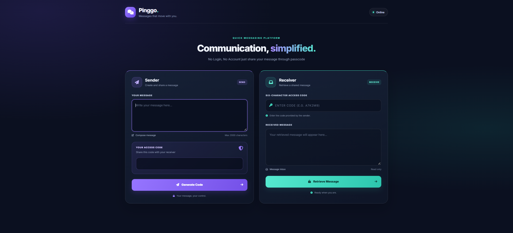

# Pinggo
## 💬 A Quick Messaging Platform

This platform doesn't require any login or signup.
This website is just for fun.

### How it works
- **Sender:** type the message ➜ click **Generate Code** ➜ copy the code and send it to the receiver.
- **Receiver:** enter the sender's code ➜ click **Receive Message** ➜ the message appears on screen.
- The time limit is only 2 minutes.

### ❓ If I already have the receiver's contact details, why use this platform?
✨ That's a valid question, and a common confusion. But imagine you are in a conference room and need to send some data to your audience or a client. Would you send an SMS to each person one by one? 🤔 No. In that situation, Pinggo makes it reliable.

✨ Sometimes you also want to share information without giving out your personal contact details. Pinggo helps with that too.

✨ For these reasons, the project is open source. Modify it to fit your needs: increase the time limit, or extend it beyond text to send photos, files, and more.

### ⚠️ Important
This data is **not end-to-end encrypted**. **DO NOT SHARE PERSONAL OR SENSITIVE INFORMATION through this website.**

### ⚙️ Installation
```bash
pip install flask
```

### 🚀 Run
```bash
python main.py
```

- Copy the local URL: `http://127.0.0.1:5000`
- Paste it into your browser and press Enter. The page is now live.

### 🖼️ Preview



### 🌐 Live Demo
Try it now: [https://pinggo.pythonanywhere.com/](https://pinggo.pythonanywhere.com/)